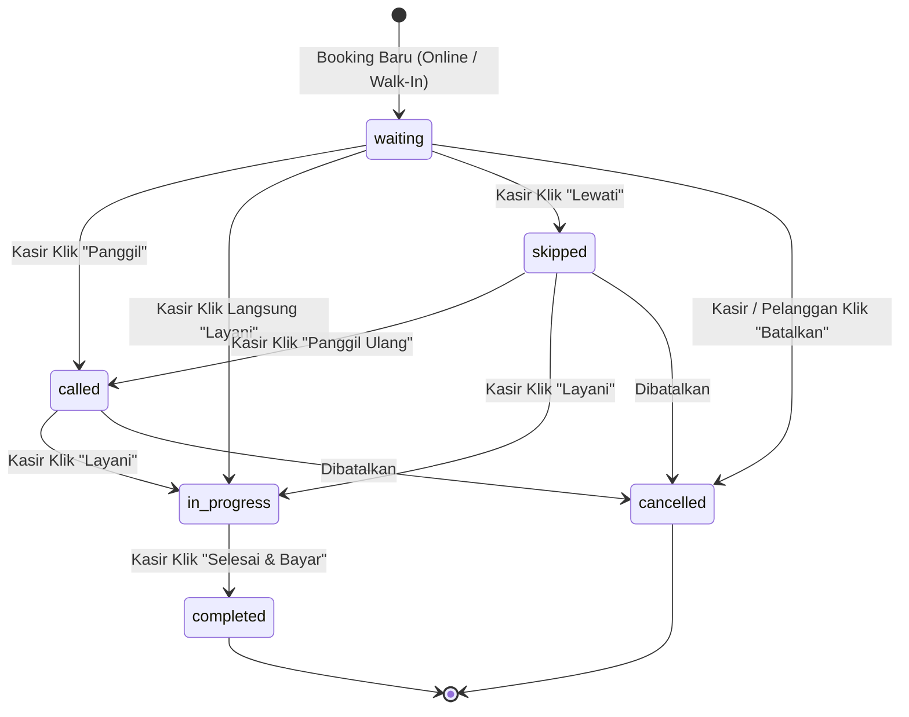

# Grooming Lab & MUA Studio — Sistem E-Booking & Manajemen Antrian

Aplikasi web modern terintegrasi untuk reservasi jadwal dan manajemen nomor antrian *real-time* layanan perawatan rambut pria (**Barbershop**) dan tata rias (**Make-Up Artist / MUA**). 

Aplikasi ini menggabungkan landing page publik interaktif, pemesanan mandiri oleh pelanggan (*mobile-first*), sistem keanggotaan VIP (Member & Diskon), operasional meja depan kasir multi-akun (*front-desk multi-cashier concurrency*), serta modul manajemen data master, staf kapster/MUA, dan laporan komprehensif oleh administrator dengan dukungan penuh **Mode Gelap (Dark Mode)** dan **Mode Terang (Light Mode)**.

---

## 📑 Daftar Isi
- [Ikhtisar & Teknologi](#-ikhtisar--teknologi)
- [Fitur Unggulan Terbaru](#-fitur-unggulan-terbaru)
  - [🌙 Mode Gelap & Terang (Dual Theme High-Contrast)](#-mode-gelap--terang-dual-theme-high-contrast)
  - [👥 Multi-Akun Kasir Konkuren (Multi-Cashier Concurrency)](#-multi-akun-kasir-konkuren-multi-cashier-concurrency)
  - [⭐ Sistem Member & Kuota Diskon Pelanggan (VIP Membership)](#-sistem-member--kuota-diskon-pelanggan-vip-membership)
  - [🔔 Siklus 3 Aksi Kasir & Pop-up Konfirmasi Interaktif](#-siklus-3-aksi-kasir--pop-up-konfirmasi-interaktif)
  - [📱 Antarmuka Responsif & Mobile-Friendly](#-antarmuka-responsif--mobile-friendly)
  - [🔐 Reset Password via Kode Verifikasi 6 Digit](#-reset-password-via-kode-verifikasi-6-digit)
  - [✨ CMS Konten Kategori Publik Dinamis](#-cms-konten-kategori-publik-dinamis)
- [Akun Demo & Akses Cepat](#-akun-demo--akses-cepat)
- [Struktur Database & Model Data](#-struktur-database--model-data)
- [Siklus Status Antrian (State Machine)](#-siklus-status-antrian-state-machine)
- [Spesifikasi Fungsional Per Peran (Role)](#-spesifikasi-fungsional-per-peran-role)
  - [1. Modul Autentikasi & Halaman Informasi Publik](#1-modul-autentikasi--halaman-informasi-publik)
  - [2. Modul Pelanggan (Customer Experience)](#2-modul-pelanggan-customer-experience)
  - [3. Modul Kasir (Front-Desk Operations)](#3-modul-kasir-front-desk-operations)
  - [4. Modul Admin (Back-Office & Executive Reporting)](#4-modul-admin-back-office--executive-reporting)
- [Panduan Instalasi & Menjalankan Proyek](#-panduan-instalasi--menjalankan-proyek)
- [Pengujian Otomatis (Automated Testing)](#-pengujian-otomatis-automated-testing)
- [Struktur Direktori Utama](#-struktur-direktori-utama)
- [Lisensi](#-lisensi)

---

## 🚀 Ikhtisar & Teknologi

- **Backend Framework:** Laravel 12 (PHP 8.2+)
- **Frontend Stack:** Tailwind CSS v3 (dengan konfigurasi `darkMode: 'class'`) + Alpine.js + Laravel Blade Components
- **Asset Bundler:** Vite
- **Database:** SQLite / MySQL Ready
- **Real-Time Synchronization:** Polling interval (5–7 detik) untuk sinkronisasi tiket antrian pelanggan dan meja kasir
- **Desain UI Dual-Theme:** 
  - *Dark Mode:* Nuansa mewah (*luxury dark*) dengan latar slate gelap (`slate-900`/`slate-950`) dan aksen emas (*amber/gold*) untuk Barbershop serta merah muda (*rose/pink*) untuk MUA Studio.
  - *Light Mode:* Tampilan bersih, profesional, dengan latar putih/slate lembut dan kontras teks tajam (*high-contrast*).

---

## 🌟 Fitur Unggulan Terbaru

### 🌙 Mode Gelap & Terang (Dual Theme High-Contrast)
- **Komponen Switcher:** Tombol beralih tema (`<x-theme-toggle />`) tersedia di seluruh layout (Guest, Pelanggan, Kasir, Admin, dan Halaman Info Publik).
- **Penyimpanan Preferensi:** Pilihan tema disimpan di `localStorage.theme` sehingga konsisten di seluruh sesi.
- **Anti-FOUC (Flash of Unstyled Content):** Skrip pendeteksi dini di `<head>` mencegah kedipan warna putih saat mode gelap aktif.
- **Kontras Tinggi & Badge Single-Line:** Teks, tabel, kartu metrik, formulir input, dan label status ("Sedang Dilayani", "Dipanggil", "Menunggu") dirancang tajam dan diproteksi `whitespace-nowrap` agar tidak patah/turun baris di resolusi apa pun.

### 👥 Multi-Akun Kasir Konkuren (Multi-Cashier Concurrency)
- **Pelayanan Bersamaan:** Beberapa akun kasir dapat aktif melayani antrian yang berbeda secara simultan tanpa saling mengunci (*non-blocking*).
- **Batasan 1 Kasir = 1 Antrian Aktif:** Mencegah satu kasir mengambil antrian baru sebelum antrian yang sedang dipegangnya diselesaikan.
- **Proteksi Penyelesaian Order:** Pesanan yang sedang dilayani kasir A hanya dapat diselesaikan (`Selesai & Bayar`) oleh kasir A. Kasir B melihat indikator informatif `"• Diproses oleh [Nama Kasir A]"`.
- **Audit Jejak Kasir:** Nama kasir yang memproses pesanan dicatat (`cashier_id`) dan ditampilkan pada tabel riwayat, dashboard, dan laporan kasir maupun admin.

### ⭐ Sistem Member & Kuota Diskon Pelanggan (VIP Membership)
- **Pendaftaran Member via Admin:** Admin dapat menetapkan pelanggan menjadi Member VIP melalui modal interaktif di menu **Data Pelanggan**.
- **Pengaturan Diskon Fleksibel:** Input potongan harga (Rp) serta kuota pemakaian diskon (berapa kali dapat diskon).
- **Auto-Potongan Saat Booking:** Saat member memesan layanan, sistem otomatis mengaplikasikan diskon dan mengurangi sisa kuota member (`member_discount_remaining`).
- **Kartu Identitas VIP di Profil:** Pelanggan member memiliki kartu digital VIP eksklusif di halaman profil yang menampilkan sisa kuota diskon secara transparan.

### 🔔 Siklus 3 Aksi Kasir & Pop-up Konfirmasi Interaktif
- **3 Aksi Utama Antrian:**
  1. **Panggil:** Memanggil nomor antrian ke meja/kursi layanan dan mengirim status visual `Dipanggil` ke pelanggan.
  2. **Layani:** Memulai pengerjaan (status `Sedang Dilayani`).
  3. **Batalkan:** Membatalkan antrian jika pelanggan berhalangan hadir.
- **Modal Konfirmasi Interaktif:** Setiap aksi krusial dilindungi pop-up dialog konfirmasi (Alpine.js) untuk mencegah ketidaksengajaan klik oleh kasir.

### 📱 Antarmuka Responsif & Mobile-Friendly
- **Kasir Mobile:** Tampilan tata letak kasir di ponsel cerdas disederhanakan (grid KPI 2 kolom minimalis, kartu antrian ringkas, dan bilah navigasi bawah: *Dashboard, Order, Pekerja, Laporan*).
- **Pelanggan Mobile-First:** Tiket antrian berukuran besar, pemantauan nomor antrian yang sedang dilayani secara *live*, dan navigasi bawah (*Home, Order, Riwayat, Profil*).
- **Sanitasi Nomor Telepon:** Seluruh input kontak/WhatsApp (Walk-in, registrasi, profil, kasir, staf) hanya menerima format angka seluler dan tanda `+`.

### 🔐 Reset Password via Kode Verifikasi 6 Digit
- Fitur lupa kata sandi yang praktis tanpa URL email rumit. Sistem menghasilkan kode verifikasi 6-digit acak dengan masa berlaku 15 menit untuk memvalidasi pembaruan sandi pelanggan.

### ✨ CMS Konten Kategori Publik Dinamis
- Halaman profil publik mendalam:
  - `/layanan/barbershop` (profil fasilitas pangkas rambut pria, paket *grooming*, dan tata tertib).
  - `/layanan/mua` (profil studio tata rias wanita, paket wisuda/bridal, dan konsultasi).
- Seluruh teks hero, fasilitas, aturan, dan foto banner dapat dikelola secara dinamis oleh Admin melalui menu **Konten Kategori**.

---

## 🔑 Akun Demo & Akses Cepat

Setelah menjalankan seeder (`php artisan db:seed`), tersedia akun demo bawaan. Halaman login juga dilengkapi tombol instan **"Login Cepat"**:

| Peran (Role) | Email | Password | URL Awal | Hak Akses Utama |
| :--- | :--- | :--- | :--- | :--- |
| **Admin** | `admin@barbershop.com` | `password` | `/admin/dashboard` | Akses penuh: Kasir, Pelanggan, Member, Layanan, Jam Kerja, Staf, Konten Kategori, Laporan |
| **Kasir Utama** | `kasir@barbershop.com` | `password` | `/kasir/dashboard` | Antrian Hari Ini, Input Walk-In, Order Mendatang, Data Pekerja (Read-Only), Laporan Harian/Mingguan |
| **Kasir Kedua** | `kasir2@barbershop.com` | `password` | `/kasir/dashboard` | Akun kasir kedua untuk uji coba *multi-cashier concurrency* |
| **Pelanggan** | `customer@example.com` | `password` | `/pelanggan/home` | Katalog layanan, booking tanggal & jam, tiket live antrian, riwayat, kartu VIP member |

---

## 🗄️ Struktur Database & Model Data

```
┌──────────────────────┐
│  category_contents   │  (CMS Konten Halaman Publik)
│(category, hero, etc.)│
└──────────────────────┘

┌──────────────────────────────────────┐       1:N       ┌─────────────────────────────────────┐
│                users                 ├────────────────►│              bookings               │
│ (role, phone, is_member, disc_quota) │                 │ (queue_number, cashier_id, disc_amt)│
└──────────────────────────────────────┘                 └──────────────────┬──────────────────┘
                                                                            │
                                                                            │ 1:N
                                                                            ▼
┌──────────────────────────────────────┐       1:N       ┌─────────────────────────────────────┐
│               services               ├────────────────►│            booking_items            │
│  (category, price, duration_minutes) │                 │      (booking_id, service, price)   │
└──────────────────────────────────────┘                 └─────────────────────────────────────┘
```

### Tabel Utama:
1. **`users`**: `id`, `name`, `email`, `phone`, `password`, `role` (`admin`, `kasir`, `pelanggan`), `is_active`, `is_member`, `member_discount_amount`, `member_discount_quota`, `member_discount_remaining`, `timestamps`.
2. **`services`**: `id`, `category` (`barbershop`, `mua`), `name`, `description`, `price`, `duration_minutes`, `image`, `is_active`, `timestamps`.
3. **`staffs`**: `id`, `name`, `role` (`kapster`, `mua`), `phone`, `is_active`, `timestamps`.
4. **`operating_hours`**: `id`, `category` (`barbershop`, `mua`), `day_of_week` (0=Minggu s/d 6=Sabtu), `open_time`, `close_time`, `is_closed`, `max_bookings_per_slot`, `timestamps`.
5. **`category_contents`**: `id`, `category` (`barbershop`, `mua`), `title`, `subtitle`, `description`, `facilities` (JSON), `rules` (JSON), `banner_url`, `timestamps`.
6. **`bookings`**: `id`, `booking_code` (e.g. `BK-20261024-XXXX`), `user_id` (nullable untuk walk-in), `customer_name`, `customer_phone`, `cashier_id` (nullable), `staff_id` (nullable), `service_category` (`barbershop`, `mua`), `booking_date`, `booking_time`, `queue_number` (`B-001`, `M-001`), `notes`, `total_price`, `discount_amount`, `status`, `timestamps`.
7. **`booking_items`**: `id`, `booking_id`, `service_id`, `price`, `timestamps`.
8. **`password_reset_codes`**: `email`, `code`, `created_at` (kode OTP 6-digit untuk pemulihan kata sandi).

---

## 🔄 Siklus Status Antrian (State Machine)

Transisi status antrian dikelola secara terstruktur dan aman:



- **Nomor Antrian Mandiri:** Prefix `B-` untuk Barbershop dan `M-` untuk MUA Studio. Nomor urut otomatis di-reset ke `001` setiap pergantian hari (`00:00` WIB).
- **Layar Pelanggan:** Menampilkan nomor antrian tertinggi yang sedang aktif dilayani pada kategori yang dipilih.

---

## 🎯 Spesifikasi Fungsional Per Peran (Role)

### 1. Modul Autentikasi & Halaman Informasi Publik
- **Login Terpusat:** Pengalihan cerdas berbasis peran (`admin`, `kasir`, `pelanggan`) dengan tombol pengisi akun demo otomatis.
- **Registrasi Pelanggan:** Validasi nama, email unik, kata sandi, dan sanitasi nomor WhatsApp hanya format angka seluler.
- **Pemulihan Sandi (OTP 6-Digit):** Input email &rarr; masukkan kode 6-digit verifikasi &rarr; ganti sandi baru.
- **Halaman Katalog Publik:** Profil Barbershop (`/layanan/barbershop`) dan MUA Studio (`/layanan/mua`) dapat diakses tanpa login.

### 2. Modul Pelanggan (Customer Experience)
- **Home:** Banner promo, katalog layanan dengan estimasi durasi dan tarif, kartu antrian aktif jika memiliki pesanan hari ini.
- **Formulir Booking:**
  - Multi-select paket layanan dengan live hitung total harga & estimasi waktu.
  - Kalender dinamis 7 hari ke depan (hari libur otomatis tidak dapat dipilih).
  - Pilihan slot waktu sesuai kapasitas dan jam operasional.
  - Penerapan otomatis potongan harga bagi pemegang Member VIP aktif.
- **Tiket Antrian (Menu Order):**
  - Nomor antrian besar dengan kartu pemantau nomor yang sedang dilayani di kursi kapster/studio.
  - Auto-sync 5 detik secara background.
  - Tombol batalkan pesanan selama antrian belum diproses.
- **Riwayat & Profil:**
  - Riwayat lengkap transaksi selesai dan dibatalkan.
  - Halaman profil dengan kartu Member VIP digital, status kuota diskon, dan ubah sandi.

### 3. Modul Kasir (Front-Desk Operations)
- **Operasional Hari Ini (Dashboard):**
  - Hanya menampilkan transaksi yang dijadwalkan pada hari berjalan.
  - Filter kategori instan: Tab Barbershop vs Tab MUA Studio.
  - Kartu ringkasan KPI (Total, Menunggu, Dipanggil, Sedang Dilayani, Selesai, Dibatalkan).
  - Kontrol antrian 3 aksi (Panggil, Layani, Batalkan) dengan modal konfirmasi interaktif.
  - Tombol *Selesai & Bayar* terproteksi kepemilikan kasir pelayan.
- **Pesanan Mendatang (Menu Order):** Melihat daftar reservasi untuk tanggal-tanggal yang akan datang.
- **Input Walk-In Order:** Formulir pemesanan tamu langsung di kasir dengan waktu otomatis saat ini (*current time*) dan nomor telepon opsional.
- **Daftar Pekerja (Menu Pekerja):** Tampilan daftar kapster & penata rias beserta status keaktifannya secara *read-only*.
- **Laporan Pelayanan Kasir (Menu Laporan):** Rekapitulasi transaksi harian dan mingguan kasir, lengkap dengan kolom kasir pelayan serta tombol cetak dan unduh Excel.

### 4. Modul Admin (Back-Office & Executive Reporting)
- **Dashboard Ringkasan Eksekutif:** Metrik performa, transaksi hari berjalan, pendapatan bulanan, dan tabel 10 pesanan terkini dengan status single-line.
- **Kelola Data Pelanggan & Member:** Pencarian data, histori booking, tombol blokir/buka blokir, reset password, dan tombol **Atur Member** untuk pendaftaran status VIP serta kuota diskon.
- **Kelola Kasir:** Pembuatan dan pemeliharaan akun-akun kasir untuk mendukung multi-kasir.
- **Kelola Katalog Layanan:** Tambah/edit layanan Barbershop dan MUA, tarif, durasi menit, dan foto.
- **Kelola Jam Kerja:** Konfigurasi jam operasional per kategori (Barbershop & MUA terpisah), batas kuota per slot, dan status tutup toko.
- **Kelola Staf:** Data master kapster dan MUA dengan toggle status keaktifan kerja.
- **Kelola Konten Kategori (CMS):** Pembaruan teks fasilitas, kebijakan studio, dan foto banner halaman publik.
- **Laporan Komprehensif Admin:** Filter rentang tanggal bebas, filter kategori, ringkasan omzet, pencatatan kasir yang melayani, ekspor berkas Excel (.csv UTF-8 BOM), dan cetak struk rekap PDF.

---

## 💻 Panduan Instalasi & Menjalankan Proyek

### 1. Prasyarat Sistem
- PHP >= 8.2 (ekstensi `pdo_sqlite` atau `pdo_mysql`, `mbstring`, `openssl`, `tokenizer`, `xml`, `curl`)
- Composer >= 2.0
- Node.js >= 18.x & NPM

### 2. Langkah Instalasi

```bash
# 1. Clone repository atau buka folder proyek
cd c:\Users\fathu\Music\GroomingLabsUnpam

# 2. Pasang dependensi PHP via Composer
composer install

# 3. Siapkan environment file
cp .env.example .env

# 4. Generate application key
php artisan key:generate

# 5. Jalankan migrasi database dan buat data awal demo
php artisan migrate:fresh --seed

# 6. Pasang dependensi frontend dan kompilasi aset
npm install
npm run build
```

### 3. Menjalankan Aplikasi

Jalankan web server lokal Laravel:
```bash
php artisan serve
```

Buka peramban (browser) dan akses:
👉 **`http://127.0.0.1:8000`**

*(Halaman akan langsung diarahkan ke `/login` yang dilengkapi tombol Login Cepat demo).*

---

## 🧪 Pengujian Otomatis (Automated Testing)

Aplikasi memiliki rangkaian pengujian fitur otomatis (*Feature & Unit Tests*) komprehensif untuk memastikan seluruh alur bisnis berjalan tanpa regresi:

```bash
php artisan test
```

### Lingkup Pengujian (49 Feature Tests — 313 Assertions):
- [x] Registrasi pelanggan dengan validasi nomor seluler
- [x] Pengalihan login berbasis role (Admin, Kasir, Pelanggan)
- [x] Pembuatan booking mandiri & auto-generate nomor antrian (`B-001`, `M-001`)
- [x] Siklus hidup kontrol antrian kasir (*Waiting &rarr; Called &rarr; In Progress &rarr; Completed*)
- [x] Konkurensi multi-kasir (multi-cashier concurrency & proteksi penyelesaian order)
- [x] Pendaftaran member pelanggan & pemotongan otomatis kuota diskon saat booking
- [x] Pembuatan pesanan Walk-in kasir dengan waktu terkini
- [x] Ekspor laporan transaksi CSV / Excel admin & kasir dengan kolom pencatatan kasir
- [x] Pengelolaan konten dinamis halaman publik kategori
- [x] Alur reset kata sandi dengan kode OTP 6-digit
- [x] Pengujian keamanan otorisasi rute per peran pengguna

**Hasil Verifikasi Terakhir:**
```text
Tests:    49 passed (313 assertions)
Duration: 4.34s
```

---

## 📁 Struktur Direktori Utama

```text
GroomingLabsUnpam/
├── app/
│   ├── Http/
│   │   ├── Controllers/
│   │   │   ├── Admin/                  # Controller Admin (Dashboard, Kasir, Pelanggan/Member, Layanan, Staf, Jam, Laporan, CategoryContent)
│   │   │   ├── Kasir/                  # Controller Kasir (Dashboard, QueueController, Walk-In, OrderController, StaffController, ReportController)
│   │   │   ├── Pelanggan/              # Controller Pelanggan (Home, Booking, Order, Riwayat)
│   │   │   ├── Auth/                   # Controller Autentikasi & PasswordResetCodeController (OTP 6-digit)
│   │   │   ├── CategoryPageController.php # Controller Profil Publik Barbershop & MUA
│   │   │   └── ProfileController.php
│   │   └── Middleware/
│   │       └── CheckRole.php           # Middleware otorisasi multi-role (admin, kasir, pelanggan)
│   └── Models/
│       ├── Booking.php                 # Model Booking, status machine, status colors, dan relasi kasir
│       ├── BookingItem.php             # Item layanan terpilih
│       ├── CategoryContent.php         # Model konten CMS halaman kategori
│       ├── OperatingHour.php           # Model jam operasional & libur per kategori
│       ├── Service.php                 # Model katalog layanan Barbershop & MUA
│       ├── Staff.php                   # Model staf kapster & MUA
│       └── User.php                    # Model pengguna dengan role helper & fitur VIP membership
├── database/
│   ├── migrations/                     # Skema tabel database (termasuk migrasi member, cashier_id, category operating hours)
│   └── seeders/DatabaseSeeder.php      # Data awal lengkap akun demo, layanan, staf, jam kerja, dan konten
├── resources/
│   ├── css/app.css                     # Tailwind CSS v3 konfigurasi dark mode
│   └── views/
│       ├── admin/                      # Blade views modul Admin & modal Atur Member
│       ├── kasir/                      # Blade views modul Kasir (Dashboard, Walk-in, Orders, Staffs, Reports)
│       ├── pelanggan/                  # Blade views modul Pelanggan (Home, Booking, Order, Riwayat, Profil VIP)
│       ├── categories/                 # Blade views halaman info publik Barbershop & MUA
│       ├── auth/                       # Blade views autentikasi & verifikasi kode OTP
│       ├── components/                 # Blade components (theme-toggle, layouts, modal)
│       └── layouts/                    # Layout master (Guest, Pelanggan, Kasir, Admin)
├── routes/
│   ├── web.php                         # Rute ber-prefix pelanggan, kasir, admin, layanan
│   └── auth.php                        # Rute autentikasi Breeze & kode reset sandi
└── tests/
    └── Feature/
        ├── BarbershopMuaSystemTest.php # 49 automated feature tests
        └── Auth/                       # Pengujian autentikasi & reset sandi
```

---

## 📄 Lisensi

Aplikasi ini dikembangkan untuk solusi operasional modern Barbershop & Make-Up Artist Studio di bawah lisensi open-source [MIT](https://opensource.org/licenses/MIT).

Aplikasi ini dikembangkan untuk solusi operasional modern Barbershop & Make-Up Artist Studio di bawah lisensi open-source [MIT](https://opensource.org/licenses/MIT).

