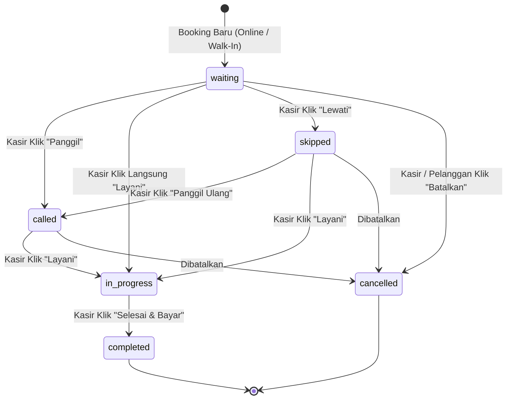

# Grooming Lab & MUA Studio — Sistem E-Booking & Manajemen Antrian

Aplikasi web modern terintegrasi untuk reservasi jadwal dan manajemen nomor antrian *real-time* layanan perawatan rambut pria (**Barbershop**) dan tata rias (**Make-Up Artist / MUA**). 

Aplikasi ini menggabungkan landing page publik interaktif, pemesanan mandiri oleh pelanggan (*mobile-first*), sistem keanggotaan VIP (Member & Diskon), operasional meja depan kasir multi-akun (*front-desk multi-cashier concurrency*), serta modul manajemen data master, staf kapster/MUA, dan laporan komprehensif oleh administrator dengan dukungan penuh **Mode Gelap (Dark Mode)** dan **Mode Terang (Light Mode)**.

---

## 📑 Daftar Isi
- [Ikhtisar & Teknologi](#-ikhtisar--teknologi)
- [Fitur Unggulan Terbaru](#-fitur-unggulan-terbaru)
  - [🌙 Mode Gelap & Terang (Dual Theme High-Contrast)](#-mode-gelap--terang-dual-theme-high-contrast)
  - [👥 Multi-Akun Kasir Konkuren (Multi-Cashier Concurrency)](#-multi-akun-kasir-konkuren-multi-cashier-concurrency)
  - [✂️ Spesialisasi Layanan Kasir & Pemilihan Kapster Cerdas](#-spesialisasi-layanan-kasir--pemilihan-kapster-cerdas)
  - [⭐ Sistem Member & Kuota Diskon Pelanggan (VIP Membership)](#-sistem-member--kuota-diskon-pelanggan-vip-membership)
  - [🔔 Siklus 3 Aksi Kasir & Pop-up Konfirmasi Interaktif](#-siklus-3-aksi-kasir--pop-up-konfirmasi-interaktif)
  - [📱 Antarmuka Responsif & Mobile-Friendly](#-antarmuka-responsif--mobile-friendly)
  - [🔍 Pencarian Multikriteria Laporan Transaksi](#-pencarian-multikriteria-laporan-transaksi)
  - [🔐 Reset Password via Kode Verifikasi 6 Digit (OTP)](#-reset-password-via-kode-verifikasi-6-digit-otp)
  - [✨ CMS Konten Kategori Publik & Halaman Login Dinamis](#-cms-konten-kategori-publik--halaman-login-dinamis)
- [Akun Demo & Akses Cepat](#-akun-demo--akses-cepat)
- [Struktur Database & Model Data](#-struktur-database--model-data)
- [Siklus Status Antrian (State Machine)](#-siklus-status-antrian-state-machine)
- [Algoritma & Logika Komputasi Sistem](#-algoritma--logika-komputasi-sistem)
- [Spesifikasi Fungsional Per Peran (Role)](#-spesifikasi-fungsional-per-peran-role)
  - [1. Modul Autentikasi & Halaman Informasi Publik](#1-modul-autentikasi--halaman-informasi-publik)
  - [2. Modul Pelanggan (Customer Experience)](#2-modul-pelanggan-customer-experience)
  - [3. Modul Kasir (Front-Desk Operations)](#3-modul-kasir-front-desk-operations)
  - [4. Modul Admin (Back-Office & Executive Reporting)](#4-modul-admin-back-office--executive-reporting)
- [Konfigurasi Email & Pengiriman OTP](#-konfigurasi-email--pengiriman-otp)
- [Panduan Instalasi & Menjalankan Proyek](#-panduan-instalasi--menjalankan-proyek)
- [Pengujian Otomatis (Automated Testing)](#-pengujian-otomatis-automated-testing)
- [Struktur Direktori Utama](#-struktur-direktori-utama)
- [Lisensi](#-lisensi)

---

## 🚀 Ikhtisar & Teknologi

- **Backend Framework:** Laravel 12 (PHP 8.3+)
- **Frontend Stack:** Tailwind CSS v3 (dengan konfigurasi `darkMode: 'class'`) + Alpine.js + Laravel Blade Components
- **Asset Bundler:** Vite
- **Database:** MySQL (Default: `barbershop_mua`) / SQLite Ready
- **Real-Time Synchronization:** Polling interval (5–7 detik) untuk sinkronisasi tiket antrian pelanggan dan meja kasir
- **Desain UI Dual-Theme:** 
  - *Dark Mode:* Nuansa mewah (*luxury dark*) dengan latar slate gelap (`slate-900`/`slate-950`) dan aksen emas (*amber/gold*) untuk Barbershop serta merah muda (*rose/pink*) untuk MUA Studio.
  - *Light Mode:* Tampilan bersih, profesional, dengan latar putih/slate lembut dan kontras teks tajam (*high-contrast*).

---

## 🌟 Fitur Unggulan Terbaru

### 🌙 Mode Gelap & Terang (Dual Theme High-Contrast)
- **Komponen Switcher:** Tombol beralih tema (`<x-theme-toggle />`) tersedia di seluruh layout (Guest, Pelanggan, Kasir, Admin, dan Halaman Info Publik).
- **Penyimpanan Preferensi:** Pilihan tema disimpan di `localStorage.theme` sehingga konsisten di seluruh sesi.
- **Anti-FOUC (Flash of Unstyled Content):** Skrip pendeteksi dini di `<head>` mencegah kedipan warna putih saat mode gelap aktif.
- **Kontras Tinggi & Badge Single-Line:** Teks, tabel, kartu metrik, formulir input, dan label status ("Sedang Dilayani", "Dipanggil", "Menunggu") dirancang tajam dan diproteksi `whitespace-nowrap inline-block` agar tidak patah/turun menjadi dua baris di resolusi layar apa pun.

### 👥 Multi-Akun Kasir Konkuren (Multi-Cashier Concurrency)
- **Pelayanan Bersamaan:** Beberapa akun kasir dapat aktif melayani antrian yang berbeda secara simultan tanpa saling mengunci (*non-blocking*).
- **Batasan 1 Kasir = 1 Antrian Aktif:** Mencegah satu kasir mengambil antrian baru sebelum antrian yang sedang dipegangnya diselesaikan.
- **Proteksi Penyelesaian Order:** Pesanan yang sedang dilayani kasir A hanya dapat diselesaikan (`Selesai & Bayar`) oleh kasir A. Kasir B melihat indikator informatif `"• Diproses oleh [Nama Kasir A]"`.
- **Audit Jejak Kasir:** Nama kasir yang memproses pesanan dicatat (`cashier_id`) dan ditampilkan pada tabel riwayat, dashboard, dan laporan kasir maupun admin.

### ✂️ Spesialisasi Layanan Kasir & Pemilihan Kapster Cerdas
- **Penetapan Layanan Kasir via Admin:** Admin dapat memilih secara spesifik layanan apa saja yang dapat dilakukan oleh kasir/kapster tersebut (hanya layanan Barbershop untuk Barberman, dan hanya layanan MUA untuk penata rias).
- **Integrasi Akun Kasir & Data Staf:** Pembuatan akun kasir terhubung langsung dengan master data staf (hanya staf yang belum dibuatkan akun kasir yang muncul pada dropdown pilihan).
- **Filter Kapster Dinamis di Halaman Pelanggan:** Saat pelanggan memilih suatu layanan, kartu staf kapster/MUA secara otomatis disaring. Staf yang memiliki kompetensi layanan tersebut dan bertugas pada tanggal yang dipilih akan berstatus **`● Tersedia`**, sedangkan staf yang tidak melayani layanan tersebut atau sedang libur akan berstatus **`● Tidak Tersedia`** dan dinonaktifkan dari pemilihan.
- **Auto-Reset Pilihan Kapster:** Jika pelanggan mengganti layanan yang dipilih ke layanan yang tidak dapat dilayani oleh kapster terpilih, sistem secara otomatis mereset pilihan kembali ke opsi netral *"⭐ Siapa Saja yang Tersedia"*.
- **Validasi Server-Side Kuat:** Sistem backend memvalidasi kembali bahwa kapster yang dipilih benar-benar berwenang menangani layanan yang di-booking.

### ⭐ Sistem Member & Kuota Diskon Pelanggan (VIP Membership)
- **Pendaftaran Member via Admin:** Admin dapat menetapkan pelanggan menjadi Member VIP melalui modal interaktif di menu **Data Pelanggan**.
- **Pengaturan Diskon Fleksibel:** Input potongan harga (Rp) serta kuota pemakaian diskon (berapa kali dapat diskon).
- **Auto-Potongan Saat Booking:** Saat member memesan layanan, sistem otomatis mengaplikasikan diskon dan mengurangi sisa kuota member (`member_discount_remaining`).
- **Kartu Identitas VIP di Profil:** Pelanggan member memiliki kartu digital VIP eksklusif di halaman profil yang menampilkan status kuota diskon secara transparan.

### 🔔 Siklus 3 Aksi Kasir & Pop-up Konfirmasi Interaktif
- **3 Aksi Utama Antrian:**
  1. **Panggil:** Memanggil nomor antrian ke meja/kursi layanan dan mengirim status visual `Dipanggil` ke pelanggan.
  2. **Layani:** Memulai pengerjaan (status `Sedang Dilayani`).
  3. **Batalkan:** Membatalkan antrian jika pelanggan berhalangan hadir.
- **Modal Konfirmasi Interaktif:** Setiap aksi krusial dilindungi pop-up dialog konfirmasi (Alpine.js) untuk mencegah ketidaksengajaan klik oleh kasir.

### 📱 Antarmuka Responsif & Mobile-Friendly
- **Alur Booking Berurutan & Tanggal Bahasa Indonesia:** Urutan form booking terstruktur: (1) Hari & Tanggal dalam Bahasa Indonesia dengan deteksi tanggal merah/libur, (2) Pilih Layanan, (3) Pilih Kapster/MUA yang Tersedia, (4) Sesi Jam 1 Jam-an, (5) Catatan Khusus, dan (6) Ringkasan Estimasi Biaya & Modal Konfirmasi.
- **Riwayat Order Bersih:** Halaman riwayat order menampilkan kartu ringkas tanpa menampilkan kode booking teknis, memprioritaskan kategori, nama layanan, waktu reservasi, status antrian, dan harga.
- **Profil Halus (Smooth Transition Accordion):** Dropdown formulir Ubah Data Diri dan Ubah Kata Sandi pada halaman profil menggunakan transisi CSS Grid (`grid-rows-[0fr]` ke `grid-rows-[1fr]`) yang mulus tanpa efek patah, serta ID akun teknis pelanggan disembunyikan agar tampilan lebih minimalis dan elegan.
- **Kasir Mobile:** Tampilan tata letak kasir di ponsel cerdas disederhanakan (grid KPI 2 kolom minimalis, kartu antrian ringkas, dan bilah navigasi bawah: *Dashboard, Order, Pekerja, Laporan*).
- **Pelanggan Mobile-First:** Tiket antrian berukuran besar, pemantauan nomor antrian yang sedang dilayani secara *live*, dan navigasi bawah (*Home, Order, Riwayat, Profil*).
- **Sanitasi Nomor Telepon:** Seluruh input kontak/WhatsApp (Walk-in, registrasi, profil, kasir, staf) secara otomatis membatasi input hanya menerima angka seluler dan tanda `+`.

### 💬 Notifikasi WhatsApp Admin Otomatis (Fonnte Gateway)
- Setiap kali ada pelanggan yang berhasil membuat pesanan booking online, sistem secara otomatis mengirimkan notifikasi WhatsApp *real-time* ke nomor WhatsApp Admin.
- Format pesan dirancang rapi dan elegan, memuat: nomor antrian, kategori & layanan, nama & nomor HP pelanggan, tanggal & jam reservasi, nama kapster bertugas, serta catatan khusus pelanggan.
- Terintegrasi aman dengan *fail-safe*: jika gateway WhatsApp sedang offline atau kehabisan kuota, transaksi booking pelanggan tetap tersimpan aman di database tanpa terganggu.

### 🔍 Pencarian Multikriteria Laporan Transaksi
- Admin dapat melakukan pencarian cepat pada menu **Laporan Transaksi** dengan kata kunci:
  - Kode Booking (misal: `BK-20261103-0001`)
  - Nomor Antrian (misal: `B-001`, `M-001`)
  - Nama Pelanggan
  - Nomor WhatsApp / HP Pelanggan
  - Nama Kasir / Staf Pelayan

### 🔐 Reset Password via Kode Verifikasi 6 Digit (Email OTP)
- Fitur pemulihan kata sandi tanpa tautan email rumit. Sistem menghasilkan kode verifikasi 6-digit acak dengan masa berlaku 15 menit.
- **Template Email HTML Elegan:** Notifikasi email dikirim dengan template HTML profesional bertema Grooming Lab langsung ke kotak masuk email pengguna.
- **Aman & Eksklusif:** Kode OTP hanya tersedia di dalam email pengguna (tidak ditampilkan pada layar aplikasi).

### ✨ CMS Konten Kategori Publik & Halaman Login Dinamis
- **Kelola Konten Profil Publik:** Informasi fasilitas, tata tertib, dan hero banner Barbershop (`/layanan/barbershop`) dan MUA Studio (`/layanan/mua`) dapat diperbarui secara dinamis oleh Admin.
- **Kelola Konten Halaman Login:** Admin dapat mengatur langsung judul sambutan, deskripsi pengantar, dan teks *experience tag* pada halaman login, lengkap dengan tombol **Pratinjau Halaman Login** interaktif.

---

## 🔑 Akun Demo & Akses Cepat

Setelah menjalankan seeder (`php artisan db:seed`), tersedia akun demo bawaan. Halaman login juga dilengkapi tombol instan **"Login Cepat"**:

| Peran (Role) | Email | Password | URL Awal | Hak Akses Utama |
| :--- | :--- | :--- | :--- | :--- |
| **Admin** | `admin@barbershop.com` | `password` | `/admin/dashboard` | Akses penuh: Kasir, Pelanggan, Member, Layanan, Jam Kerja, Staf, Konten Kategori, Laporan |
| **Kasir Utama** | `kasir@barbershop.com` | `password` | `/kasir/dashboard` | Antrian Hari Ini, Input Walk-In, Order Mendatang, Data Pekerja (Read-Only), Laporan Harian/Mingguan |
| **Kasir Kedua** | `kasir2@barbershop.com` | `password` | `/kasir/dashboard` | Akun kasir kedua untuk uji coba *multi-cashier concurrency* |
| **Pelanggan** | `customer@example.com` | `password` | `/pelanggan/home` | Katalog layanan, booking tanggal & jam, tiket live antrian, riwayat, kartu VIP member |

---

## 🗄️ Struktur Database & Model Data

```
┌──────────────────────┐
│  category_contents   │  (CMS Konten Halaman Publik)
│(category, hero, etc.)│
└──────────────────────┘

┌──────────────────────────────────────┐       1:1       ┌─────────────────────────────────────┐
│                users                 ├────────────────►│              customers              │
│ (role, phone, is_active, timestamps) │                 │  (name, phone, is_member, discount) │
└──────────────────┬───────────────────┘                 └──────────────────┬──────────────────┘
                   │                                                        │
                   │ 1:N                                                    │ 1:N
                   ▼                                                        ▼
┌──────────────────────────────────────────────────────────────────────────────────────────────┐
│                                          bookings                                            │
│ (queue_number, user_id, customer_id, cashier_id, total_price, discount_amount, status)       │
└──────────────────────────────────────────────┬───────────────────────────────────────────────┘
                                               │
                                               │ 1:N
                                               ▼
┌──────────────────────────────────────┐       1:N       ┌─────────────────────────────────────┐
│               services               ├────────────────►│            booking_items            │
│  (category, price, duration_minutes) │                 │      (booking_id, service, price)   │
└──────────────────────────────────────┘                 └─────────────────────────────────────┘
```

### Tabel Utama:
1. **`users`**: `id`, `name`, `email`, `phone`, `password`, `role` (`admin`, `kasir`, `pelanggan`), `service_category` (`barbershop`, `mua`), `work_days` (JSON array hari bertugas), `avatar`, `is_active`, `is_member`, `member_discount`, `member_discount_type`, `member_discount_quota`, `member_discount_remaining`, `timestamps`.
2. **`customers`** (Data & Profil Pelanggan): `id`, `user_id` (nullable, foreign key ke `users`), `name`, `phone`, `email`, `address`, `is_member`, `member_discount`, `member_discount_type`, `member_discount_quota`, `member_discount_remaining`, `notes`, `timestamps`.
3. **`services`**: `id`, `category` (`barbershop`, `mua`), `name`, `description`, `price`, `duration_minutes`, `image`, `is_active`, `timestamps`.
4. **`service_user`** (Pivot Layanan Kasir): `user_id` (foreign key ke `users`), `service_id` (foreign key ke `services`). Mengatur spesialisasi layanan per kasir.
5. **`staffs`**: `id`, `name`, `role` (`kapster`, `mua`), `phone`, `email`, `is_active`, `timestamps`.
6. **`operating_hours`**: `id`, `category` (`barbershop`, `mua`), `day_of_week` (0=Minggu s/d 6=Sabtu), `open_time`, `close_time`, `is_closed`, `max_bookings_per_slot`, `timestamps`.
7. **`category_contents`**: `id`, `category` (`barbershop`, `mua`), `title`, `subtitle`, `description`, `facilities` (JSON), `rules` (JSON), `banner_url`, `timestamps`.
8. **`bookings`**: `id`, `booking_code` (e.g. `BK-20261025-XXXX`), `user_id` (nullable untuk walk-in), `customer_id` (nullable, foreign key ke `customers`), `customer_name`, `customer_phone`, `cashier_id` (nullable), `staff_id` (nullable), `service_category` (`barbershop`, `mua`), `booking_date`, `booking_time`, `queue_number` (`B-001`, `M-001`), `notes`, `total_price`, `discount_amount`, `status`, `timestamps`.
9. **`booking_items`**: `id`, `booking_id`, `service_id`, `price`, `timestamps`.
10. **`password_reset_tokens`**: `email`, `token`, `created_at` (token hashed kode OTP 6-digit untuk pemulihan kata sandi).

---

## 🔄 Siklus Status Antrian (State Machine)

Transisi status antrian dikelola secara terstruktur dan aman:



- **Nomor Antrian Mandiri:** Prefix `B-` untuk Barbershop dan `M-` untuk MUA Studio. Nomor urut otomatis di-reset ke `001` setiap pergantian hari (`00:00` WIB).
- **Layar Pelanggan:** Menampilkan nomor antrian tertinggi/terupdate yang sedang aktif dilayani pada kategori yang dipilih.

---

## 🧠 Algoritma & Logika Komputasi Sistem

Aplikasi ini mengimplementasikan serangkaian algoritma, model komputasi, dan arsitektur pengamanan data untuk memastikan keandalan, integritas transaksi, serta keadilan antrian:

### 1. Algoritma Penjadwalan Antrian Berprioritas (*Priority Queue Scheduling*)
* **Lokasi Implementasi:** `app/Http/Controllers/Kasir/DashboardController.php`
* **Prinsip Kerja:** Tampilan antrian kasir tidak hanya menggunakan urutan waktu kedatangan murni, melainkan menerapkan pembobotan status (*Status Weighting Priority*):
  $$\text{Priority Rank} = \begin{cases}
  1 & \text{jika } status = \text{'in\_progress' (Sedang Dilayani)} \\
  2 & \text{jika } status = \text{'called' (Dipanggil)} \\
  3 & \text{jika } status = \text{'waiting' (Menunggu Giliran)} \\
  4 & \text{jika } status = \text{'skipped' (Dilewati)} \\
  5 & \text{jika } status = \text{'completed' (Selesai)} \\
  6 & \text{jika } status = \text{'cancelled' (Dibatalkan)}
  \end{cases}$$
* **Tie-Breaker:** Jika bobot prioritas sama, diurutkan sekunder berdasarkan waktu pemesanan (`booking_time ASC`) dan nomor antrian terawal (`queue_number ASC`). Hal ini menjamin kasir langsung fokus menyelesaikan antrian yang sedang berjalan di kursi/meja layanan sebelum melayani antrian berikutnya.

### 2. Algoritma FIFO dengan Partisi Kategori & Waktu (*First-In, First-Out Queue Partitioning*)
* **Lokasi Implementasi:** `app/Models/Booking.php` (`generateQueueNumber()`)
* **Prinsip Kerja:** Pembagian nomor antrian mandiri per kategori dan per hari:
  * Barbershop: format `B-001`, `B-002`, dst.
  * MUA Studio: format `M-001`, `M-002`, dst.
  * Formula: $N_{antrian} = \text{COUNT}(\text{kategori}, \text{tanggal}) + 1$.
  * Nomor urut otomatis di-reset ke `001` setiap pergantian hari kalender (`00:00` WIB) tanpa saling mengganggu antara Barbershop dan MUA Studio.

### 3. Algoritma Alokasi Kapasitas Slot Waktu & Deteksi Konflik (*Time-Slot Capacity & Conflict Detection*)
* **Lokasi Implementasi:** `app/Http/Controllers/Pelanggan/BookingController.php`
* **Prinsip Kerja:**
  * **Window Boundary Check:** Memvalidasi jam reservasi berada dalam interval jam buka dan tutup operasional: $t_{booking} \in [t_{open}, t_{close})$.
  * **Slot Threshold Limit:** Mengecek kapasitas paralel kuota kursi/kapster per jam:
    $$\text{COUNT}(booking\_time = t, \ status \neq 'cancelled') < max\_bookings\_per\_slot$$
    (Kapasitas default: 5 pelanggan/slot untuk Barbershop, 2 pelanggan/slot untuk MUA Studio).
  * **Double Booking Prevention:** Mencegah satu akun pelanggan memesan jam yang persis sama di kategori lain saat sudah memiliki tiket aktif.

### 4. Algoritma Kontrol Konkurensi Kasir (*Pessimistic Concurrency Guard & Ownership Lock*)
* **Lokasi Implementasi:** `app/Http/Controllers/Kasir/QueueController.php`
* **Prinsip Kerja:**
  * **Single Active Task Constraint:** Akun kasir yang sedang memiliki status `in_progress` dilarang memanggil/melayani antrian baru sebelum antrian aktifnya diselesaikan:
    $$\exists \ b \in \text{Bookings} \ (\text{cashier\_id} = \text{auth\_id} \land \text{status} = 'in\_progress') \implies \text{REJECT}$$
  * **Exclusive Ownership Lock:** Transaksi yang sedang dilayani kasir A hanya dapat diselesaikan (*Complete & Pay*) oleh kasir A. Kasir B ditolak jika mencoba menyelesaikan transaksi milik kasir lain.

### 5. Algoritma Mesin Status Berhingga (*Finite State Machine - FSM*)
* **Lokasi Implementasi:** `app/Models/Booking.php` & `app/Http/Controllers/Kasir/QueueController.php`
* **Prinsip Kerja:** Memastikan alur status antrian bersifat deterministik dan linear. Status akhir (`completed` atau `cancelled`) bersifat *terminal state* (tidak dapat diubah kembali ke status sebelumnya).

### 6. Algoritma Mesin Kalkulasi Diskon VIP & Pemotongan Kuota (*Discount & Quota Decrement Engine*)
* **Lokasi Implementasi:** `app/Models/User.php` (`calculateDiscount()`)
* **Prinsip Kerja:**
  * **Tipe Persentase:** $Diskon = \min\left(P_{asli}, \ \text{round}\left(\frac{P_{asli} \times Diskon_{\%}}{100}\right)\right)$
  * **Tipe Nominal Tetap (Fixed):** $Diskon = \min\left(P_{asli}, \ Diskon_{Rp}\right)$
  * **Total Akhir:** $P_{total} = \max(0, \ P_{asli} - Diskon)$
  * **Atomic Decrement:** Mengurangi sisa kuota keanggotaan `member_discount_remaining` secara atomik saat pesanan berhasil disimpan.

### 7. Algoritma Kriptografi & Keamanan (*CSPRNG, Hashing, & TTL Expiration*)
* **Lokasi Implementasi:** `app/Http/Controllers/Auth/PasswordResetCodeController.php`
* **Prinsip Kerja:**
  * **CSPRNG (Cryptographically Secure Pseudo-Random Number Generator):** Fungsi `random_int(100000, 999999)` untuk membangkitkan 6 digit kode OTP verifikasi reset sandi dengan entropi tinggi dan resistan terhadap tebakan acak.
  * **One-Way Hashing (Bcrypt):** Kata sandi akun dan kode OTP dienkripsi dengan algoritma Blowfish cipher (`Hash::make()` / `Hash::check()`).
  * **Time-to-Live (TTL) Expiration:** Validasi masa aktif kode OTP dengan batas waktu 15 menit menggunakan delta waktu:
    $$\Delta t = t_{now} - t_{created} \le 15 \text{ menit}$$

### 8. Algoritma Validasi & Sanitasi Pola (*Regular Expression Pattern Matching*)
* **Lokasi Implementasi:** `Walk-in Form`, `Registration`, `Profile`, `Customer Management`
* **Prinsip Kerja:** Sanitasi karakter string nomor kontak melalui ekspresi reguler `/^[0-9+]+$/` untuk menolak input selain nomor seluler dan tanda plus (`+`), mencegah celah XSS (*Cross-Site Scripting*) dan injeksi karakter berbahaya.

### 9. Algoritma Agregasi Data & Analisis Statistik Laporan (*Data Aggregation & Metrics Summary*)
* **Lokasi Implementasi:** `app/Http/Controllers/Admin/ReportController.php` & `app/Http/Controllers/Kasir/ReportController.php`
* **Prinsip Kerja:** Melakukan penyaringan baris data berdasar rentang waktu sembarang $[T_{start}, T_{end}]$ dan partisi kategori, kemudian menghitung:
  * Omzet riil (hanya dari status `completed`).
  * Rasio konversi pesanan selesai versus pesanan batal/dilewati.
  * Ekspor streaming berkas Excel Spreadsheet (.xlsx) dan CSV dengan *header UTF-8 BOM* agar terbaca sempurna di Microsoft Excel.

---

## 🎯 Spesifikasi Fungsional Per Peran (Role)

### 1. Modul Autentikasi & Halaman Informasi Publik
- **Login Terpusat:** Pengalihan cerdas berbasis peran (`admin`, `kasir`, `pelanggan`) dengan tombol pengisi akun demo otomatis.
- **Registrasi Pelanggan:** Validasi nama, email unik, kata sandi, dan sanitasi nomor WhatsApp hanya format angka seluler.
- **Pemulihan Sandi (OTP 6-Digit):** Input email &rarr; masukkan kode 6-digit verifikasi &rarr; buat kata sandi baru.
- **Halaman Katalog Publik:** Profil Barbershop (`/layanan/barbershop`) dan MUA Studio (`/layanan/mua`) dapat diakses tanpa login.

### 2. Modul Pelanggan (Customer Experience)
- **Home:** Banner promo, katalog layanan dengan estimasi durasi dan tarif, kartu antrian aktif jika memiliki pesanan hari ini.
- **Formulir Booking 6 Langkah Terstruktur:**
  1. *Pilih Hari & Tanggal:* Kalender 7 hari ke depan berbahasa Indonesia dengan deteksi otomatis tanggal merah & hari libur operasional.
  2. *Pilih 1 Layanan:* Pemilihan paket layanan dengan visual kartu berdaya kontras tinggi di mode terang maupun gelap.
  3. *Pilih Kapster / MUA Bertugas:* Menampilkan status `● Tersedia` bagi kapster yang bertugas pada hari tersebut dan kompeten melayani layanan yang dipilih pelanggan, atau `● Tidak Tersedia` jika sedang libur atau tidak melayani layanan tersebut. Opsi netral *"Siapa Saja yang Tersedia"* tetap tersedia.
  4. *Pilih Sesi Jam (Rentang 1 Jam):* Slot waktu jam 09.00 s/d 21.00 WIB dengan indikator sisa kuota dan perlindungan sesi terlewat.
  5. *Catatan Khusus (Opsional):* Kolom input preferensi potongan rambut atau preferensi riasan wajah.
  6. *Ringkasan Estimasi Biaya & Modal Konfirmasi:* Kalkulasi harga normal, potongan member VIP otomatis, dan konfirmasi pesanan interaktif.
- **Tiket Antrian (Menu Order):**
  - Nomor antrian besar dengan kartu pemantau nomor yang sedang dilayani di kursi kapster/studio.
  - Auto-sync 5 detik secara background.
  - Tombol batalkan pesanan selama antrian belum diproses.
- **Riwayat Order:**
  - Riwayat lengkap pesanan selesai dan dibatalkan tanpa menampilkan kode booking teknis yang membingungkan.
  - Filter kategori instan (Semua, Barbershop, MUA Studio).
- **Profil Pelanggan:**
  - Kartu Member VIP digital eksklusif dengan info kuota diskon tersisa.
  - Formulir Ubah Data Diri dan Ubah Kata Sandi dengan transisi akordeon yang mulus (*smooth collapse/expand*).
  - Tampilan ID akun teknis disembunyikan agar profil lebih rapi dan personal.

### 3. Modul Kasir (Front-Desk Operations)
- **Operasional Hari Ini (Dashboard):**
  - Hanya menampilkan transaksi yang dijadwalkan pada hari berjalan.
  - Filter kategori instan: Tab Barbershop vs Tab MUA Studio.
  - Kartu ringkasan KPI (Total, Menunggu, Dipanggil, Sedang Dilayani, Selesai, Dibatalkan).
  - Kontrol antrian 3 aksi (Panggil, Layani, Batalkan) dengan modal konfirmasi interaktif.
  - Tombol *Selesai & Bayar* terproteksi kepemilikan kasir pelayan.
- **Pesanan Mendatang (Menu Order):** Melihat daftar reservasi untuk tanggal-tanggal yang akan datang.
- **Input Walk-In Order:** Formulir pemesanan tamu langsung di kasir dengan waktu otomatis saat ini (*current time*) dan nomor telepon opsional.
- **Daftar Pekerja (Menu Pekerja):** Tampilan daftar kapster & penata rias beserta status keaktifannya secara *read-only* bagi kasir.
- **Laporan Pelayanan Kasir (Menu Laporan):** Rekapitulasi transaksi harian dan mingguan kasir, lengkap dengan kolom kasir pelayan serta tombol cetak struk dan unduh Excel.

### 4. Modul Admin (Back-Office & Executive Reporting)
- **Dashboard Ringkasan Eksekutif:** Metrik performa, transaksi hari berjalan, pendapatan bulanan, dan tabel 10 pesanan terkini dengan status single-line.
- **Kelola Data Pelanggan & Member:** Pencarian data, histori booking, tombol blokir/buka blokir, reset password, dan tombol **Atur Member** untuk pendaftaran status VIP serta kuota diskon.
- **Kelola Kasir & Jadwal:**
  - Pembuatan akun kasir terintegrasi langsung dengan data karyawan staf (dropdown otomatis menyaring staf yang belum berakun kasir).
  - Pengaturan spesialisasi layanan kasir (hanya checklist Barbershop untuk Barberman, dan checklist MUA untuk penata rias).
  - Tabel kasir yang rapi dengan kolom peran terpisah dan status ketersediaan *Tersedia / Tidak Tersedia*.
- **Kelola Master Staf:** Manajemen data kapster & MUA, lengkap dengan kontak WhatsApp, alamat email, dan radio button status keaktifan staf.
- **Kelola Katalog Layanan:** Tambah/edit layanan Barbershop dan MUA, tarif, durasi menit, dan foto.
- **Kelola Jam Kerja:** Konfigurasi jam operasional per kategori (Barbershop & MUA terpisah), batas kuota per slot, dan status tutup toko.
- **Kelola Konten Kategori & Login (CMS):** Pembaruan teks fasilitas, kebijakan studio, foto banner publik, dan konfigurasi teks halaman login dengan tombol pratinjau login interaktif.
- **Laporan Komprehensif Admin:** Pencarian multikriteria instan (kode booking, nomor antrian, nama pelanggan, telepon, nama kasir), filter rentang tanggal, filter kategori, ringkasan omzet, ekspor Excel (.xlsx/.csv), dan cetak PDF.

---

## 📧 Konfigurasi Email & Pengiriman OTP

### Mode 1: Driver Log (storage/logs/laravel.log)
Jika menggunakan `MAIL_MAILER=log`, email dicatat ke file `storage/logs/laravel.log` tanpa koneksi internet.

### Mode 2: Pengiriman Riil ke Gmail (SMTP)
Sistem menggunakan SMTP Gmail agar kode verifikasi 6 digit dikirim langsung secara riil ke inbox pengguna:
1. Buat **Google App Password (16 Digit)** di [Google Account Security](https://myaccount.google.com/apppasswords) *(memerlukan 2FA aktif)*.
2. Perbarui variabel di file `.env`:
   ```env
   MAIL_MAILER=smtp
   MAIL_HOST=smtp.gmail.com
   MAIL_PORT=587
   MAIL_USERNAME=emailanda@gmail.com
   MAIL_PASSWORD=abcdefghijklmnop
   MAIL_FROM_ADDRESS="emailanda@gmail.com"
   MAIL_FROM_NAME="Grooming Lab & MUA Studio"
   ```
3. Restart server pengembangan (`php artisan serve`).

---

## 💻 Panduan Instalasi & Menjalankan Proyek

### 1. Prasyarat Sistem
- PHP >= 8.3 (ekstensi `pdo_sqlite` atau `pdo_mysql`, `mbstring`, `openssl`, `tokenizer`, `xml`, `curl`)
- Composer >= 2.0
- Node.js >= 18.x & NPM
- MySQL Server (misal: XAMPP / Laragon / Native MySQL)

### 2. Langkah Instalasi

```bash
# 1. Buka terminal pada folder proyek
cd c:\Users\fathu\Music\GroomingLabsUnpam

# 2. Pasang dependensi PHP via Composer
composer install

# 3. Siapkan file konfigurasi environment
cp .env.example .env

# 4. Generate application key
php artisan key:generate

# 5. Konfigurasikan database pada file .env (buat database MySQL: barbershop_mua)
# DB_CONNECTION=mysql
# DB_HOST=127.0.0.1
# DB_PORT=3306
# DB_DATABASE=barbershop_mua
# DB_USERNAME=root
# DB_PASSWORD=

# 6. Jalankan migrasi database dan pengisian data demo (seeder)
php artisan migrate:fresh --seed

# 7. Pasang dependensi JavaScript dan kompilasi aset frontend
npm install
npm run build
```

### 3. Menjalankan Aplikasi

Jalankan web server lokal Laravel:
```bash
php artisan serve
```

Buka browser dan kunjungi:
👉 **`http://127.0.0.1:8000`**

*(Halaman akan langsung diarahkan ke `/login` yang dilengkapi tombol Login Cepat untuk demonstrasi ketiga peran).*

---

## 🧪 Pengujian Otomatis (Automated Testing)

Aplikasi memiliki rangkaian pengujian fitur otomatis (*Feature & Unit Tests*) komprehensif untuk memastikan seluruh alur bisnis berjalan tanpa regresi:

```bash
php artisan test
```

### Lingkup Pengujian (83 Feature & Unit Tests — 631 Assertions):
- [x] Registrasi pelanggan dengan validasi format nomor seluler
- [x] Pengalihan login berbasis peran pengguna (Admin, Kasir, Pelanggan)
- [x] Alur booking terstruktur (Hari/Tanggal Indo, Layanan, Kapster Bertugas, Sesi Jam, Catatan, Ringkasan)
- [x] Pembuatan booking mandiri & auto-generate nomor antrian (`B-001`, `M-001`)
- [x] Notifikasi WhatsApp otomatis ke Admin saat ada booking baru & proteksi fail-safe
- [x] Sinkronisasi spesialisasi layanan kasir/kapster & proteksi pemilihan kapster yang kompeten
- [x] Siklus hidup kontrol antrian kasir (*Waiting &rarr; Called &rarr; In Progress &rarr; Completed*)
- [x] Konkurensi multi-kasir (multi-cashier concurrency & proteksi penyelesaian order)
- [x] Pendaftaran member pelanggan & pemotongan otomatis kuota diskon saat booking
- [x] Pembuatan pesanan Walk-in kasir dengan waktu terkini
- [x] Fitur pencarian multikriteria laporan transaksi admin (kode booking, antrian, nama, HP, staf/kasir)
- [x] Ekspor laporan transaksi CSV / Excel admin & kasir dengan kolom pencatatan kasir
- [x] Pengelolaan konten dinamis halaman publik kategori dan halaman login oleh Admin
- [x] Alur reset kata sandi dengan kode OTP 6-digit & fitur kirim ulang kode
- [x] Pengujian antarmuka mode gelap (dual theme), kebersihan tampilan tanggal tanpa angka dobel
- [x] Pengujian keamanan otorisasi rute per peran pengguna

**Hasil Verifikasi Terakhir:**
```text
Tests:    83 passed (631 assertions)
Duration: 5.48s
```

---

## 📁 Struktur Direktori Utama

```text
GroomingLabsUnpam/
├── app/
│   ├── Http/
│   │   ├── Controllers/
│   │   │   ├── Admin/                  # Controller Admin (Dashboard, Kasir, Pelanggan/Member, Layanan, Staf, Jam, Laporan, CategoryContent)
│   │   │   ├── Kasir/                  # Controller Kasir (Dashboard, QueueController, Walk-In, OrderController, StaffController, ReportController)
│   │   │   ├── Pelanggan/              # Controller Pelanggan (Home, Booking, Order, Riwayat)
│   │   │   ├── Auth/                   # Controller Autentikasi & PasswordResetCodeController (OTP 6-digit)
│   │   │   ├── CategoryPageController.php # Controller Profil Publik Barbershop & MUA
│   │   │   └── ProfileController.php
│   │   └── Middleware/
│   │       └── CheckRole.php           # Middleware otorisasi multi-role (admin, kasir, pelanggan)
│   └── Models/
│       ├── Booking.php                 # Model Booking, status machine, status colors, dan relasi kasir
│       ├── BookingItem.php             # Item layanan terpilih
│       ├── CategoryContent.php         # Model konten CMS halaman kategori
│       ├── OperatingHour.php           # Model jam operasional & libur per kategori
│       ├── Service.php                 # Model katalog layanan Barbershop & MUA
│       ├── Staff.php                   # Model staf kapster & MUA
│       └── User.php                    # Model pengguna dengan role helper & fitur VIP membership
├── database/
│   ├── migrations/                     # Skema tabel database (termasuk migrasi member, cashier_id, category operating hours)
│   └── seeders/DatabaseSeeder.php      # Data awal lengkap akun demo, layanan, staf, jam kerja, dan konten
├── resources/
│   ├── css/app.css                     # Tailwind CSS v3 konfigurasi dark mode
│   └── views/
│       ├── admin/                      # Blade views modul Admin & modal Atur Member
│       ├── kasir/                      # Blade views modul Kasir (Dashboard, Walk-in, Orders, Staffs, Reports)
│       ├── pelanggan/                  # Blade views modul Pelanggan (Home, Booking, Order, Riwayat, Profil VIP)
│       ├── categories/                 # Blade views halaman info publik Barbershop & MUA
│       ├── auth/                       # Blade views autentikasi & verifikasi kode OTP
│       ├── components/                 # Blade components (theme-toggle, layouts, modal)
│       └── layouts/                    # Layout master (Guest, Pelanggan, Kasir, Admin)
├── routes/
│   ├── web.php                         # Rute ber-prefix pelanggan, kasir, admin, layanan
│   └── auth.php                        # Rute autentikasi Breeze & kode reset sandi
└── tests/
    └── Feature/
        ├── BarbershopMuaSystemTest.php # 44 automated feature tests skenario operasional
        └── Auth/                       # 6 automated feature tests autentikasi & OTP reset sandi
```

---

## 📄 Lisensi

Aplikasi ini dikembangkan untuk solusi operasional modern Barbershop & Make-Up Artist Studio di bawah lisensi open-source [MIT](https://opensource.org/licenses/MIT).
